# ian-baseform36


The TRIO firmware is what you want if you're running Baseform with a Central Module, this is the default/standard version that all units ship with.

The DUO firmware is for running the Baseform without the Central Module. Your left half acts as a Central. This version has limited testing, and might have bugs.

<!-- FIRMWARE-LINKS:START - Do not edit below, this section is managed by CI -->
Run the publish workflow to generate links.

<!-- FIRMWARE-LINKS:END -->

## Keymap visualizations



The image is generated by keymap-drawer from the keymap. Combos are not drawn. See [`docs/keymap/`](docs/keymap/README.md) for the layer table and HTML views of the Miryoku Colemak-DH layout with the custom DEV layer.

## Game mode (WoW)

Game mode is for playing with the keyboard and a mouse. The OS input is QWERTY and Colemak-DH is done in firmware, so the game layers send QWERTY keycodes.

- Enter and exit: tap Q+W+F together (30ms combo). There is a brief lag on Q/W/TAB only on the first press after a pause.
- Backup exit: hold GFN (left middle thumb) + the top pinky key.
- GFN: hold the left middle thumb for a second set of keys.
- CHAT: GFN + the home pinky key, or the right inner thumb. It sends Enter and leaves game mode, so you can type in Colemak-DH. Re-enter with Q+W+F.
- ESC: GFN + the bottom pinky key, or the right outer thumb.
- Right half in GAME is the WoW window keys (vanilla defaults): P spellbook, M map, N talents, B bags, L quest log, K skills, H honor, U reputation, O social, / slash chat. G is the character pane: rebind Toggle Character Pane to G in WoW, because C is an ability key.
- BUTTON layer: hold Z+X+C on the base layer for Bluetooth profiles, bootloader and reset.

```
GAME
 TAB    Q      W      E      R    |  J      L      U      Y      P
 1      A      S      D      F    |  M      N      B      I      O
 2      Z      X      C      V    |  K      H      G      .      /
        SHIFT  [GFN]  SPACE       |  CHAT   SPACE  ESC
GFN (right half same as GAME)
 EXIT   3      W      4      5
 CHAT   A      S      D      6
 ESC    8      9      0      -
        -      [held] SPACE
```


## Paired nvim config

The companion repo [`idvd20/nvim-baseform36`](https://github.com/idvd20/nvim-baseform36) ships a Neovim + tmux setup tuned for this keymap.


[Learn about the Baseform Keyboard here](https://posture.works/baseform/)


