# Baseform 36 — Keymap Visualizations

Open any of the HTML files directly in your browser — they're self-contained, no server needed.

## Layers

| Layer | When it activates | What it does | Visualization |
|---|---|---|---|
| Base | always | letters, home row mods (GUI/ALT/CTRL/SHFT) | [01-base.html](01-base.html) |
| **DEV** | hold right inner thumb (TAB) | nvim save / quit / hunk-nav / window movement / jumplist | [02-dev.html](02-dev.html) |
| NAV | hold right thumb (SPC) | arrows (← ↓ ↑ →), PgUp/PgDn, Cmd combos | [03-nav.html](03-nav.html) |
| SYM | hold left inner thumb (RET) | `:` `;` `{ } [ ]` `* %` and friends | [04-sym.html](04-sym.html) |
| NUM | hold left middle thumb (BSPC) | digits 0-9, brackets, `=` `\` | [05-num.html](05-num.html) |
| BUTTON | hold Z+X+C (combo) | Bluetooth profiles, bootloader, reset | [keymap.svg](keymap.svg) |
| GAME | toggle with Q+W+F (combo) | WoW on the left half, plain QWERTY keycodes | [keymap.svg](keymap.svg) |
| GFN | hold left middle thumb in GAME | number keys 3-0, ESC, chat, exit game mode | [keymap.svg](keymap.svg) |

## Generated image

[keymap.svg](keymap.svg) is drawn by keymap-drawer from `config/miryoku-colemakdh/baseform.keymap` (all layers, combos omitted). `keymap.yaml` is the parsed keymap and `draw-config.yaml` holds the settings and regeneration commands.

## Reading the HTML diagrams

- **Orange-bordered keys** = home row mods or layer-specific action keys
- **Blue text on thumb keys** = layer name when held (e.g., "NAV", "DEV")
- **Top text on thumb keys** = tap action (e.g., "SPC", "TAB")

## Workflow paired with this layout

See [`idvd20/nvim-baseform36`](https://github.com/idvd20/nvim-baseform36) — the Neovim + tmux config built specifically for this keyboard.
